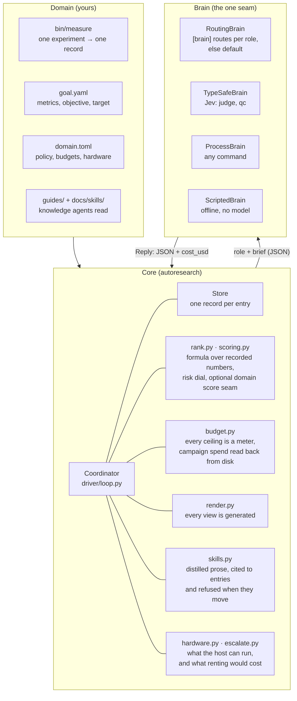
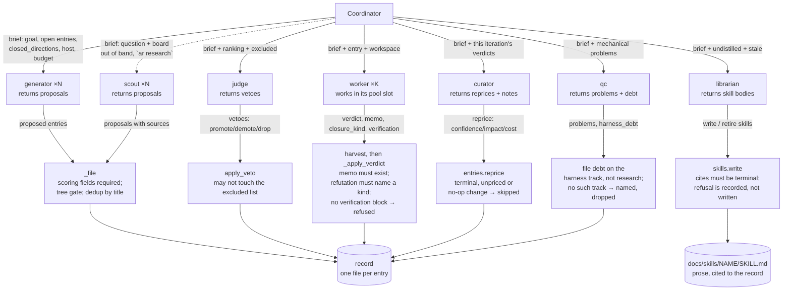
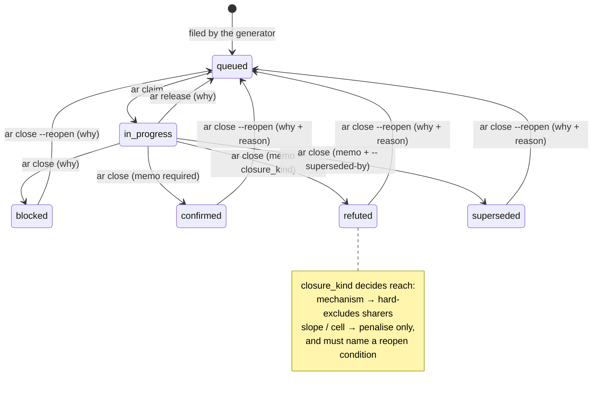
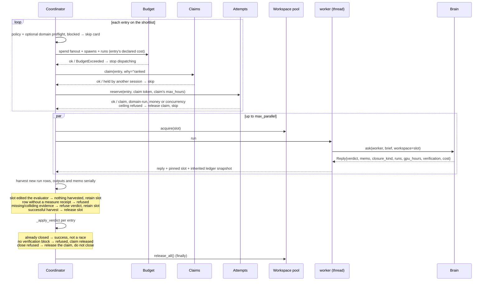
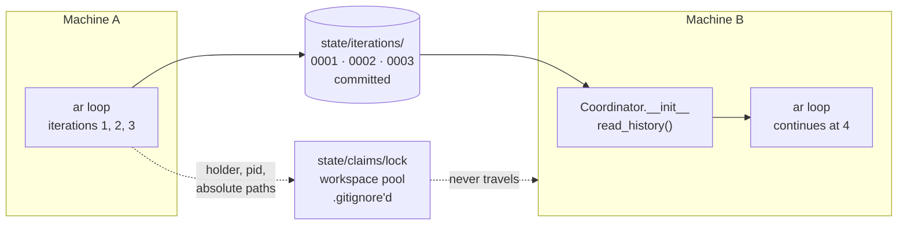

# Architecture

Six diagrams. The first says who owns what; the rest expand one iteration,
the roles inside it, the entry lifecycle, the worker pool, and how a campaign
moves between machines.

Everything here is drawn from `src/autoresearch/driver/loop.py` (the
coordinator), `driver/brain.py` (the model seam), `states.py` (the lifecycle),
`rank.py` (the formula, hard filters and the risk dial), `scoring.py` (the
domain score seam), `tree.py` (the filing gate), `preflight.py` (the dispatch
gate), `claims.py` and `attempts.py` (claims and run reservations),
`external.py` (native handoff), `budget.py` (meters and the stop decision),
`skills.py` (distillation) and `workspaces.py` (the pool).

## 1. The three layers

A domain supplies measurement, goal, policy and knowledge. Core owns the loop,
the record and every meter. The brain is the one seam judgement passes through,
and it is swappable — which is what makes `ar loop` a unit test rather than a
bill.

Core never calls a model directly and the brain never touches the record: a
role returns JSON, and the coordinator decides what — if anything — that JSON
is allowed to change.

The campaign meters are the ones to watch in `budget.py`. `domain.money` and
`domain.gpu_hours` are rebuilt at startup from what the iteration records on
disk already say was spent, not from zero: a campaign ceiling reconstructed
fresh in each process is not a ceiling but a per-invocation allowance, renewable
with the up-arrow.

## 2. One iteration, seven phases

Every phase is metered and records what it *read* and what it *did*, so a phase
that did nothing is distinguishable from a phase that did not run.

```mermaid
flowchart LR
    start(["run_iteration(n)"]) --> orient
    orient["orient<br/>read record, resolve target,<br/>reap dead claims,<br/>report resumed history"]
    generate["generate<br/>N generators, in parallel<br/>with each other"]
    rankp["rank<br/>score + hard filters, domain seam,<br/>judge vetoes, then the risk dial<br/>picks the shortlist"]
    dispatch["dispatch<br/>claim → reserve → worker → verdict<br/>(native: claim → assignment)"]
    curate["curate<br/>re-price what moved,<br/>write views"]
    distil["distil<br/>promote closed work into<br/>cited skills, on a cadence"]
    qc["qc<br/>mechanical first, model second"]
    stop{"should_stop?"}

    c1{"time and<br/>money?"}
    c2{"time and<br/>money?"}
    c3{"time and<br/>money?"}
    nat{"native, with<br/>assignments<br/>outstanding?"}

    orient --> c1
    c1 -->|"yes"| generate --> c2
    c2 -->|"yes"| rankp --> c3
    c3 -->|"yes"| dispatch --> nat
    c1 -.->|"no"| c2
    c2 -.->|"no"| c3
    c3 -.->|"no"| nat
    nat -->|"no"| curate
    curate --> distil --> qc --> stop
    nat -.->|"yes: curate, distil, qc<br/>recorded as skipped"| stop
    stop -->|"running"| orient
    stop -->|"target met /<br/>budget spent /<br/>yield floor /<br/>native-handoff"| done(["stop"])

    teardown["pool.release_all()<br/>in a finally"]
    dispatch -.-> teardown
    qc -.-> teardown
```

Six things about this shape are deliberate:

- **Generate runs first, every iteration the gate allows**, so the queue is
  refilled before rank drains it rather than starving behind a rule that
  forbids draining it. It finishes before rank begins; only its N generators
  (`coordinator.generators_per_iteration`) run in parallel, with each other.
- **The coordinator owns the pool.** Teardown is a `finally`, not a runbook.
- **`distil` is not clock-gated, and sits before `qc`.** Like `curate` it closes
  out work already paid for -- a verdict that never became knowledge is the run
  charged twice -- and putting it ahead of `qc` means the same iteration that
  wrote a skill also checks it. Its cadence is a domain decision
  (`coordinator.distil_every`), and a cadence-skipped phase records *why*, so
  "no cadence" and "nothing to distil" and "the librarian was refused" are three
  distinguishable lines rather than one blank.
- **QC is mechanical first.** `ar validate`-style checks answer most of it with
  no model; the QC role is asked only about what code cannot check. Among the
  mechanical checks since the corpus taught the class: a closed `confirmed`
  entry's typed summary is traced against the run ledger — every non-trivial
  number in it must be a row metric, that row's objective value, the row
  count, or arithmetic over matched values (AgentRxiv's fabricated results,
  arXiv 2503.18102; CodeScientist's unfaithful experiments, arXiv 2503.22708).
- **Wall clock and money gate the three phases that start new work.**
  `generate`, `rank` and `dispatch` each ask `_time_left` before beginning,
  and it refuses on either meter: the iteration's `iteration_max_seconds` is
  spent, or the campaign's money is exhausted or unknown (`_require_money` —
  an unpriced spend under a finite ceiling refuses, as it does for every
  metered call). `curate`, `distil` and `qc` are not gated, because they close
  out work that has already been paid for; the one case that skips them is
  native dispatch, below. A phase the gate skips is written to the record
  *with its reason* — which is what makes the distinguishability claim above
  true rather than aspirational. The check is made separately before each of
  the three (the dotted edges), not once for the group: an iteration can
  generate, then run out of clock before it dispatches.
- **Native dispatch ends the iteration at the handoff.** With `[coordinator]
  dispatch = "native"`, dispatch goes to `_dispatch_native`: each shortlisted
  card gets the same preflight, meter charges and claim, then an external
  assignment (`external.assign`) instead of a worker, and no model runs in this
  process for the work. While any assignment is outstanding there is nothing
  to close out, so `curate`, `distil` and `qc` do not run but are recorded
  with the reason (`native dispatch: N assignment(s) outstanding` for curate
  and distil; `settle assignments first; qc runs with the verdicts` for qc), and the
  stop decision is replaced by `native-handoff`, whose detail names the
  resume: settle with `ar external complete`, then run `ar loop` again.
  Looping on would re-rank a queue whose claims are still held. `ar loop`
  prints the manifest of assignments; the full shape is in
  [native-driver.md](native-driver.md).

Every model call spends a `spawns` meter, QC's included, so the ceiling that
makes a runaway iteration structurally impossible counts every role that ran.

The rank phase is where the search becomes a **tree**: every entry is a
branch (its `parent` names work already in the record) or a novel root, and
the coordinator refuses an unknown parent, a lineage past `tree_max_depth`,
a parent past `tree_max_children`, a stagnant parent or a cross-track branch
at filing (`tree.py`), with the reason in the generate phase's detail lines.
The order inside the phase is fixed (`Coordinator.rank`):

1. `rank.rank` applies the hard filters — a `mechanism`-refuted direction, a
   stagnant lineage, a cost the remaining runs cannot pay — and prices the
   survivors by the formula;
2. a declared `[commands] score` seam (`scoring.seam_ranking`) re-prices the
   claimable survivors; a seam failure refuses the phase and skips dispatch
   rather than falling back to the formula the domain replaced;
3. the judge's vetoes are applied to the full ranking (`apply_veto` refuses
   one against an excluded entry);
4. only then does `shortlist(k)` apply the risk dial, splitting the `k` slots
   between novel entries and branches.

Because the hard filters run first, neither the dial nor a domain's prices
can resurrect what they excluded. An entry counts as novel only with no
`parent` *and* no `derived_from`: a follow-up filed past the depth cap is
lineage, not new territory. The formula, the dial, stagnation and the seam's
contract are documented once, in the README's
[Ranking: the tree, the risk dial, and the domain's own score](../README.md#ranking-the-tree-the-risk-dial-and-the-domains-own-score).

## 3. Roles, and what each may return

Seven prompts in `src/autoresearch/agents/`. Core does not grant or withhold
tools: a brain is a command, `ProcessBrain` substitutes only `{role}`,
`{prompt_file}`, `{workspace}` and `{cost_file}` into it, and what that
command's agent may touch is the backend's configuration — route a role to a
restricted agent if you want it restricted. (Per-role tool lists belonged to
the SDK brain, removed in 0.2.0.) What core enforces is the other half: every
role returns JSON, the coordinator is the only writer of the record, and each
reply passes a check before it changes anything — the librarian returns a
skill body and the coordinator writes it, so no role certifies its own
output. The worker is the one role handed a `{workspace}`: a pool slot, whose
results reach the record only through harvest.

The right-hand boxes are the enforcement points. A role proposes; the
coordinator is the only thing that writes, and it refuses anything that breaks
an invariant — a close with a missing memo, a veto against a hard filter, a
re-price of a terminal entry, a proposal without its scoring inputs.

## 4. An entry's lifecycle

The state machine is total: no status is terminal by omission, every terminal
status has a route back, and every reason-bearing edge demands a reason.

`in_progress` is spelled `in-progress` in the record; Mermaid will not take the
hyphen in a state id.

Reopening a verdict also names its kind, `--reopen-reason` (`REOPEN_REASONS` in
`states.py`): `weak`, `overclaim`, `context` or `clerical`. It is stored on the
transition event as `snapshot: {reopen_reason: ...}`, a field every core
already reads, so records written with it load on older cores. `blocked` is not
a verdict, so its reopen takes no reason and refuses one.

This is the research track's machine. A track declares its own terminal set and
nothing else about the shape changes — the harness-debt track the toy domain
ships uses `fixed`/`wontfix`/`refuted` in place of `confirmed`/`refuted`, and
gets the same reopen edge on each, because `default_machine` takes the terminal
set as its only parameter. `superseded` is the one status no track has to
declare: retirement is not a claim about a hypothesis and not a statement that
the scaffolding broke, so it belongs to every queue. `ar close --superseded-by`
is its only writer, and the relation lands in the replacement's own
`supersedes`, so a retired entry always names what absorbed it (H15).

## 5. Dispatch and the worker pool

Liveness is observed, not inferred: the coordinator submits the work, so it
knows when a worker finished. TTL reaping in `orient` is the fallback for a
holder that died elsewhere.

Before allocating each selected entry, dispatch checks the measurement command
against the domain's human-only policy. An optional `[commands].preflight`
command then receives `{"entry": <entry record>}` on stdin, in the domain root.
It runs as shell-free argv with a 10-second timeout and must exit zero with
one JSON object containing `feasible` (boolean) and `reason` (string).
A false result needs a nonempty reason. Policy refusal, timeout, nonzero exit
or malformed output records a blocked verdict and skips the card without
spending dispatch resources or creating a claim/workspace. Domains without a
hook retain existing behavior after the measurement-command policy check.
The hook is domain-owned and must be read-only; this is not a sandbox or a
substitute for native-agent permission checks.

**Replication at the close boundary.** `[coordinator] confirm_runs` (default 1)
demands that many valid run rows in the ledger before a `confirmed` experiment
closure is accepted — on both close paths (`_apply_verdict` and `ar close`),
so neither can bypass the other's guard. A short ledger refuses the close and
releases the claim back to the queue; `refuted` verdicts are exempt, because a
legitimate refutation may hold only `invalid`/`failed` rows and demanding
clean rows for a `no` would cry wolf. This is per-entry replication, weaker
than the goal-level `confirm_independently` — a second row from a different
*source*, meaning another workspace slot or a proven claim (a free session
name is not one, #43; `runs.source_of`), or a passing holdout — and the two
guard different threats: one noisy run closing a discovery versus a
proxy overfitting across claims.

A worker that raises is recorded as `failed` *against its entry id* — the item
is part of the answer, because a failure that reads as a result is the exact
shape this harness keeps filing defects about.

Two details in the first block are load-bearing. `runs` is spent at *dispatch*,
from the entry's declared cost, not after the worker reports: every card is
dispatched before any of them answers, so a meter charged after the fact bounds
nothing. After each worker returns, new rows and declared findings are retained
in the coordinator's configured ledger before its workspace is removed.
Missing evidence refuses a measured verdict and leaves the workspace pinned
for inspection, while reported consumption is still charged conservatively.
`run_ids` on each iteration identifies retained rows so restarting does not
charge them twice; historical iterations without IDs remain conservative.
GPU-hours use the greater of worker-reported consumption and retained row cost.
Consumption is attributed to the original claim instance in `runs_by_entry`,
with its session and `claim_at` timestamp captured before dispatch. `ar budget`
matches both fields; resolved claims must not charge a later same-session
claim. Legacy attribution without a timestamp remains part of campaign
consumption but cannot be assigned to a current claim. Direct ledger rows are
counted only when their start time falls within the current claim.

## 6. Resuming on another machine

The coordination primitives are single-filesystem, so two machines working in
parallel is not supported. *Sequential* handoff is, and it turns on one thing:
`state/iterations/` is read as well as written.

`Coordinator.__init__` reads every iteration record back, so numbering
continues from the highest one (reusing a recorded number is refused before
any phase runs) and `yield_floor` keeps its window across the handoff. The
claim lock and the workspace pool never travel: they name a holder, a pid and
absolute paths that mean nothing on the other machine. What to commit, what
stays behind, the one-session-name rule and crash recovery are in the
README's [Working across two machines](../README.md#working-across-two-machines).
